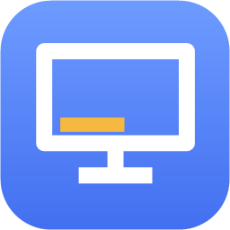
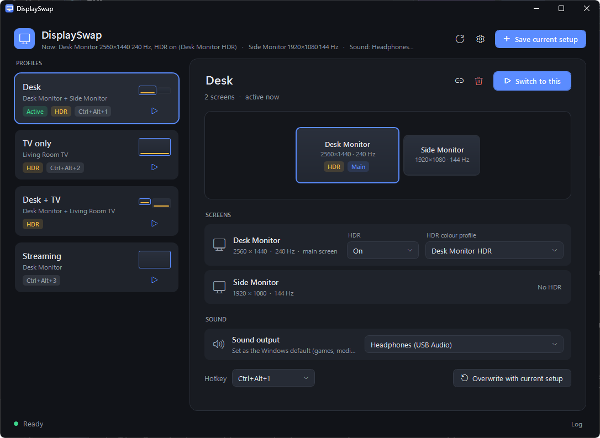
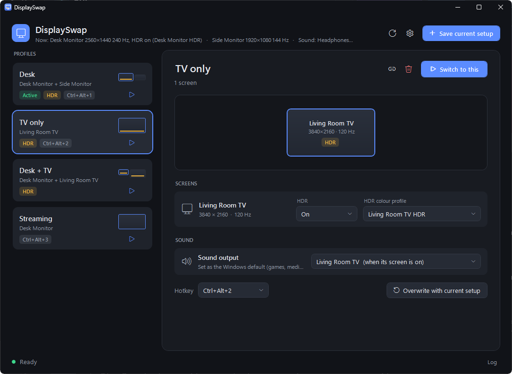
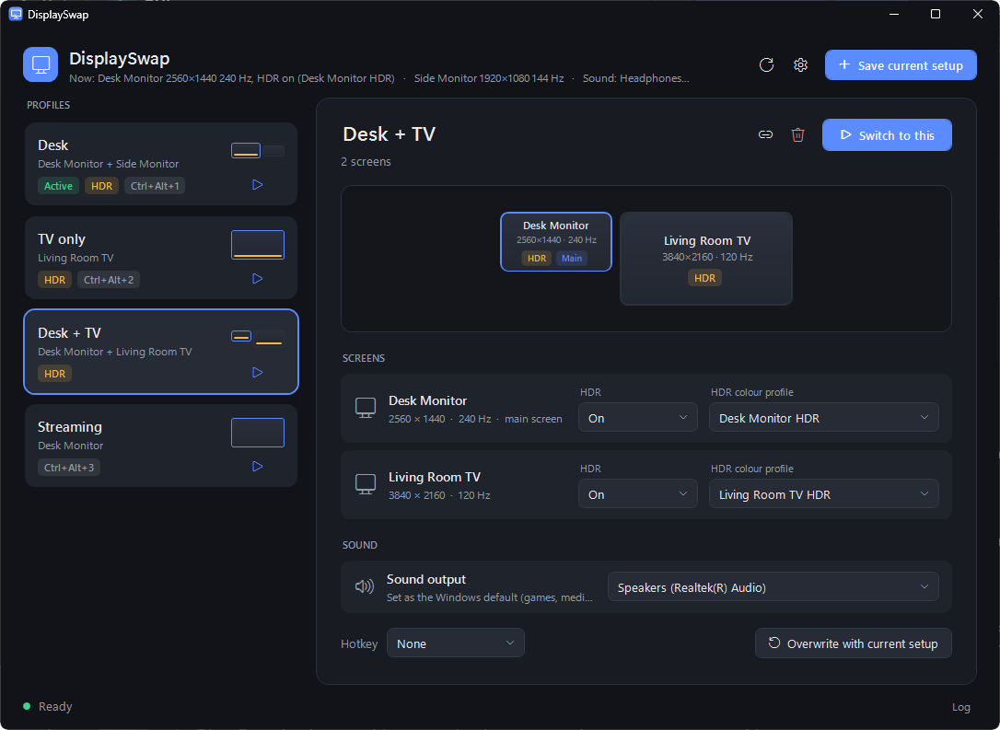
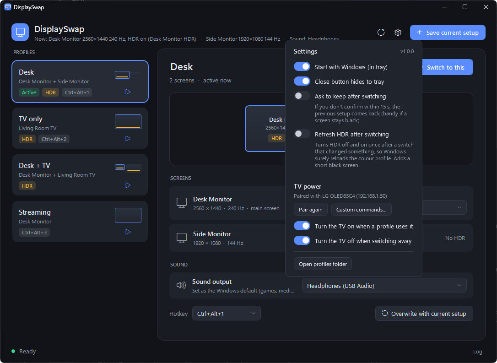
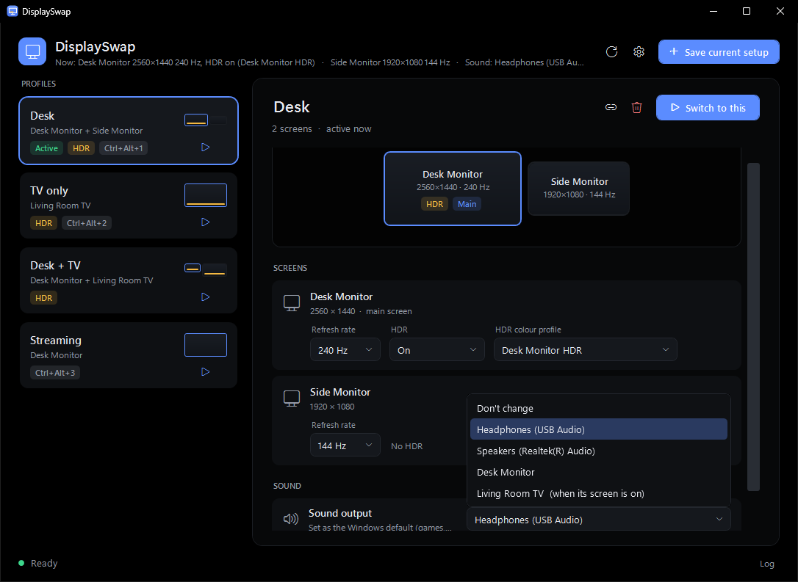
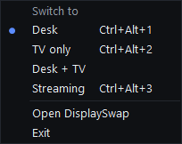

<p align="center">
  
</p>

<h1 align="center">DisplaySwap</h1>

<p align="center">
  <b>One-click switching between your monitor and TV setups on Windows, with HDR, colour profiles and sound.</b>
</p>

<p align="center">
  <a href="../../releases/latest"></a>
  
  <a href="LICENSE"></a>
</p>

<p align="center">
  
</p>

Save setups like **Desk**, **TV only** or **Desk + TV** and switch between them with one click, a hotkey,
the tray or automatically when a game starts. Each switch also turns HDR on or off, picks the right HDR
colour profile for every screen and changes the sound output, which Windows normally makes you redo by hand.

## Screenshots

<table>
  <tr>
    <td width="50%"><br><sub><b>TV only:</b> HDR, calibration profile and TV speakers in one profile</sub></td>
    <td width="50%"><br><sub><b>Desk + TV:</b> each screen gets its own HDR settings</sub></td>
  </tr>
  <tr>
    <td width="50%"><br><sub><b>Settings:</b> start with Windows, safety net and TV power</sub></td>
    <td width="50%"><br><sub><b>Sound output</b> per profile, including TV audio that only exists while the TV is on</sub></td>
  </tr>
</table>

<p align="center">
  <br>
  <sub>Switch from the tray, with the active profile marked</sub>
</p>

## Features

- **Display profiles.** Save the screens Windows is showing (which screens are on, resolution, refresh
  rate, position, main screen) and switch back to that setup later.
- **Refresh rate per screen.** Pick the refresh rate each screen runs at, from the rates it supports.
- **HDR per screen.** Turn HDR on or off for each screen as part of the profile.
- **HDR colour profile per screen.** Pick which Windows HDR Calibration profile each screen uses. It is
  set on the right monitor even when screens take turns on the same graphics card output.
- **Sound output per profile.** For example the TV's speakers for *TV only* and your headphones at the
  desk. TV audio is found by name, because Windows re-creates HDMI audio devices with new IDs.
- **Tray menu and hotkeys.** Switch from the tray, or with Ctrl+Alt+1–9 / F1–F12.
- **Desktop shortcuts.** One click makes a shortcut that switches to a profile (handy in Steam).
- **Playnite extension.** Right-click a game → *Monitor profile* → pick a profile. DisplaySwap switches
  when the game starts and switches back when it closes.
- **TV power (optional).** Turn the TV on before switching to a profile that uses it, and off again when
  you switch away. Supports LG (webOS), Samsung (Tizen, 2016+), Sony Bravia and Roku TVs, plus your own
  commands for any other TV (a web address such as a Home Assistant webhook, or a command line).
- **Recovery after a crash.** If a game session switched your screens and Playnite closed or crashed
  before it could switch back, DisplaySwap offers to restore your previous setup.
- **Optional safety net.** Ask "Keep this setup?" after switching and go back automatically after
  15 seconds if you don't confirm (useful if a screen stays black).
- **Portable.** No installer. Settings live next to `DisplaySwap.exe`.

## Download and install

1. Download **`DisplaySwap-vX.Y.Z.zip`** from [Releases](../../releases) and unzip it anywhere,
   for example `C:\Tools\DisplaySwap`.
2. Run `DisplaySwap.exe`.
   Windows SmartScreen may warn the first time because the app isn't code-signed: click
   *More info → Run anyway*.
3. Set your screens up in Windows (Win+P or *Settings → Display*), with HDR the way you want it, then
   click **Save current setup**. Repeat for each setup.
4. For each profile, pick the refresh rate, HDR mode, HDR colour profile and sound output you want.

Requirements: Windows 10 (version 2004 or later) or Windows 11, 64-bit. The .NET Framework 4.8
it needs is already part of Windows.

## Playnite extension

1. Run DisplaySwap at least once (this tells the extension where it is).
2. Download **`DisplaySwap-Playnite-vX.Y.Z.pext`** from [Releases](../../releases) and double-click it,
   or drag it onto Playnite. Restart Playnite when asked.
3. Right-click a game (or several) → **Monitor profile** → choose a profile, or *Don't switch*.

The choice is stored as a Playnite tag such as `DisplaySwap: TV only`, so you can filter your library
by it. A progress window shows while the screens switch, and the game starts once they are ready.

## TV power

Open the gear menu → **TV power**:

- **Find & pair TV** looks for LG, Samsung, Sony and Roku TVs on your network and lists what it
  found. Pick the TV that is connected to this PC (you are always asked, even if only one TV answers,
  so no other TV in the house gets a prompt). Then:
  - **LG / Samsung:** accept the prompt that appears on the TV.
  - **Sony:** on the TV, set *IP control → Authentication* to *Normal and Pre-Shared Key*, choose a key,
    turn on *Remote start*, and enter the same key in DisplaySwap.
  - **Roku TV:** nothing to accept.
- **Custom commands...** works with any TV: enter what turns it on and off, as a web address
  (`https://...`, or `POST https://...`) or a command line.
- Turn on **Turn the TV on when a profile uses it** and/or **Turn the TV off when switching away**.

Turning a TV on uses Wake-on-LAN for LG and Samsung, so the TV has to allow being woken over the network:

- **LG:** turn on **TV On With Mobile** (*Turn on via Wi-Fi*, or *Turn on via LAN* if the TV is wired).
  It is under *Settings → General → Devices → External Devices*; the exact path differs between webOS
  versions. Without it the TV can still be turned off, but not on.
- **Samsung:** turn on **Power On with Mobile** (*Settings → General → Network → Expert Settings*).

The TV is only turned off if it was being used as a screen before the switch.

**Network use:** DisplaySwap only scans your network when you click *Find & pair TV*. It never scans in
the background or at startup. When the TV power options are on, a switch talks only to the one paired TV
at its saved address (plus a Wake-on-LAN packet when it has to turn the TV on).

## Command line

```
DisplaySwap.exe --apply "TV only"              switch to a profile
DisplaySwap.exe --apply "TV only" --remember   save the current setup first, then switch
DisplaySwap.exe --restore                      go back to the setup saved by --remember
DisplaySwap.exe --list                         list profile names
DisplaySwap.exe --status                       show the screens Windows sees right now
DisplaySwap.exe --tray                         start hidden in the tray
DisplaySwap.exe --version
```

## Files

Everything is stored next to `DisplaySwap.exe` (or in `%APPDATA%\DisplaySwap` if that folder can't be
written to):

| File | Contents |
|---|---|
| `profiles.json` | your profiles and settings, including the TV's pairing key |
| `previous-setup.json` | the setup to go back to after a game (only while a session is running) |
| `DisplaySwap.log` | what each switch did, useful when something goes wrong |

DisplaySwap also writes its own location to `HKCU\Software\DisplaySwap` so the Playnite extension can find
it. *Start with Windows* adds an entry under `HKCU\...\CurrentVersion\Run`.

## Known limitations

- TV power is tested with LG webOS TVs. Samsung, Sony and Roku support is written against their
  published or community-documented protocols but hasn't been tested on real TVs yet. Reports welcome.
- Setting the default sound device uses Windows' undocumented `IPolicyConfig` interface (the same one
  SoundSwitch and EarTrumpet use). It has been stable for years but isn't official.
- The app isn't code-signed, so SmartScreen and some antivirus tools may warn about it.

## Building from source

No SDK or Visual Studio needed: Windows already includes the C# compiler for .NET Framework 4.x.

```powershell
.\build.ps1                                  # builds dist\DisplaySwap-vX.Y.Z.zip (+ the .pext if Playnite is found)
.\build.ps1 -PlayniteDir "D:\Playnite"       # Playnite installed somewhere else
.\build.ps1 -Install "C:\Tools\DisplaySwap"   # also copy the new exe into your install folder
.\build.ps1 -InstallPlaynite                 # also install the extension into Playnite (close it first)
```

The extension needs `Playnite.SDK.dll` from a Playnite install to build. The app itself has no
external dependencies.

## License

[MIT](LICENSE). See [THIRD-PARTY-NOTICES.md](THIRD-PARTY-NOTICES.md) for the LG pairing manifest
taken from lgtv2.
